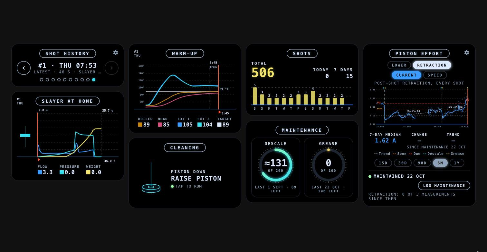

# Meticulous Espresso Cards

[](https://hacs.xyz/docs/faq/custom_repositories)

Home Assistant dashboard cards for the Meticulous espresso machine,
styled like the machine's own screen. They only need the
[Meticulous Espresso integration](https://github.com/hessius/ha-meticulous). A calendar for the
maintenance log is an optional extra; everything else is set up from the cards themselves.



| Card | What it shows |
|---|---|
| `meticulous-shot-card` | The last shot: pressure, flow, weight and piston position, live while brewing |
| `meticulous-heatup-card` | Temperatures while the machine warms up, live while heating |
| `meticulous-history-navigator-card` | Step back through recent shots on the shot and warm-up cards |
| `meticulous-cleaning-card` | Raise/lower the piston, live piston graphic, cleaning reminder |
| `meticulous-shot-count-card` | Total shots, today, last 7 days and a 14-day bar chart |
| `meticulous-maintenance-counter-card` | Shots since the last descale and grease, against intervals you set |
| `meticulous-maintenance-effort-card` | Piston friction over time, maintenance levels and a forecast |

Renamed in 1.1.0: `meticulous-plunger-card` → `meticulous-cleaning-card`, `meticulous-shots-card` →
`meticulous-shot-count-card`, `meticulous-history-card` → `meticulous-history-navigator-card`,
`meticulous-maintenance-card` → `meticulous-maintenance-counter-card` and `meticulous-effort-card` →
`meticulous-maintenance-effort-card`. The old names still work, so existing dashboards keep running,
but they no longer appear in the card picker.

## Maintenance: two cards to choose from

The maintenance cards help you set **your own** maintenance triggers. They don't replace the
manufacturer's advice: when in doubt, follow Meticulous's
[maintenance and repair recommendations](https://meticuloushome.com/pages/maintenance-and-repairs).

There are two maintenance cards. Use either one, or both:

| | Maintenance counter (`meticulous-maintenance-counter-card`) | Maintenance effort (`meticulous-maintenance-effort-card`) |
|---|---|---|
| **What it tracks** | Shots since the last descale and since the last grease | The motor current needed to move the piston, i.e. piston friction |
| **When it says maintenance is due** | After the number of shots you set for each | When friction reaches the levels you set, with a forecast in days and shots |
| **Needs** | The shot counter | The integration's piston sensors |
| **Best for** | A simple, predictable schedule | Maintenance based on the machine's actual condition |

**Neither card can tell you *what* needs doing:**
- The maintenance counter only counts shots. It doesn't measure the machine's condition.
- The maintenance effort card measures **total** friction. Running out of grease, scale build-up and
  coffee residue in the cylinder all add to that friction, and the card can't tell them apart.

When either card says maintenance is due, it's up to you to check whether the piston needs
greasing, or the cylinder needs descaling or cleaning of coffee residue. Log what you did on the
card: that resets the counter, or starts a new friction cycle.

## Requirements

- The [Meticulous Espresso integration](https://github.com/hessius/ha-meticulous).
- The cleaning card's piston graphic, the shot card's piston line and the piston effort card use
  the integration's **piston sensors** (*Piston Position*, *Piston Lower …*, *Piston After-Shot …*).
  These are proposed in [hessius/ha-meticulous#2](https://github.com/hessius/ha-meticulous/pull/2).
  Without them those parts show a short message or fall back to the machine state; everything else
  works.
- Tested with Home Assistant 2026.10.

## Installation

### HACS (recommended)

1. HACS → ⋮ → **Custom repositories** → add `https://github.com/cjborchert/ha-meticulous-cards`
   with type **Dashboard**.
2. Install **Meticulous Espresso Cards** and reload the browser.

HACS adds the resource for you (`/hacsfiles/ha-meticulous-cards/meticulous-cards.js`). All seven
cards are in that one file.

### Manual

Copy `dist/meticulous-cards.js` to `/config/www/` and add it as a dashboard resource
(Settings → Dashboards → ⋮ → Resources) with URL `/local/meticulous-cards.js`, type
**JavaScript module**.

## Configuration

Every card accepts `prefix:` (default `meticulous_espresso`): the part between `sensor.` and
`_state` of your machine's state sensor. Entities that Home Assistant named differently after a
device rename are found automatically on the same device.

```yaml
type: custom:meticulous-shot-card
flow_max: 15          # optional y-axis maxima
pressure_max: 12
weight_max: 55        # grows automatically for heavier shots
```

```yaml
type: custom:meticulous-heatup-card
days: 10              # optional: how far back to look for the last warm-up
```

```yaml
type: custom:meticulous-history-navigator-card
count: 5              # shots to look back (also set from its gear)
compact: false        # true: no title pill, for tight layouts
```

```yaml
type: custom:meticulous-cleaning-card
reminder: true        # false removes the cleaning reminder
```

```yaml
type: custom:meticulous-shot-count-card
```

```yaml
type: custom:meticulous-maintenance-counter-card
calendar: calendar.home_maintenance   # optional: log descales/greases to this calendar
descale_interval: 200                 # shots; starting values until you change them with the gear
grease_interval: 100
```

```yaml
type: custom:meticulous-maintenance-effort-card
calendar: calendar.home_maintenance   # optional: where "Log maintenance" adds events
```

If a card can't find the machine it says **Machine not found** and which entity it looked for.

## How the cards work

### Cleaning card (`meticulous-cleaning-card`)

- Raises or lowers the piston with the integration's *Home* and *Purge* buttons. You confirm each
  move unless you are reversing a move made in the last 2 minutes.
- The piston graphic follows the **Piston Position** sensor (0 = top, about 76 = bottom), if it is
  enabled. Otherwise it uses the last *Home* or *Purge* state. While the piston moves, a dashed ring
  pulses at its destination.
- Status line:

  | Machine | Card shows |
  |---|---|
  | Heating / Preheating / Starting | HEATING |
  | Retract and fill before a shot | STARTING SHOT |
  | During the shot | BREWING · *current profile stage* · time |
  | Retract after the shot | SHOT DONE · Retracting · purge next |
  | Click to Purge | PUSH TO PURGE, with the machine's cup animation |
  | Purge, piston still moving | LOWERING… |
  | Purge, piston already at the bottom | DEPRESSURIZING. The machine stays in *Purge* for another 20–30 s while it depressurizes. The card can only detect this with the Piston Position sensor. |

- **Cleaning reminder**: after a shot the status line reads *Clean due · n shots* until the piston
  is raised. You can turn this off with the gear icon; the setting is kept with the machine's settings
  (see *Where settings are kept*). Set `reminder: false` to remove the reminder completely.

### Shot card, warm-up card and history navigator

- **Shot card**: the last brewing cycle (`binary_sensor.<prefix>_brewing` off → on → off), loaded
  from recorder history. While a shot runs it plots live, redrawing at most 5 times a second so
  slow wall tablets keep up.
- **Warm-up card**: the boiler, brew head and external temperatures plus the target, from the moment
  the machine starts heating until the shot starts. It plots live and marks when the machine became
  READY. Sensors that are disabled in the integration are left out.
- **History navigator card**: ◀ ▶ arrows and dots to step back through recent shots. The gear sets how
  many shots to look back (1–20, default 5). The shot and warm-up cards on the same page follow the
  selection and show a small tag such as `#2 / 10:50`. The count is kept with the machine's settings. Whenever the machine starts heating or brewing,
  every card jumps back to live. Without a history navigator on the page, both cards simply show the
  latest shot.

### Where settings are kept

Settings you change on the cards (maintenance levels and the measure they use, maintenance
intervals, the cleaning reminder, how many shots the history navigator shows) and the maintenance log
(when there is no calendar) are saved **per Meticulous machine**, not per Home Assistant user, so
every user, phone and wall panel sees the same values. The cards keep them in Home Assistant's own
frontend storage under the key `meticulous-cards`, one entry per machine (its device in Home
Assistant), so nothing extra has to be set up. Changes made on one screen show up on the others
straight away.

- Everyone can **see** the settings, but Home Assistant only lets **admins change** them. For other
  users the maintenance effort card's gear menu is read-only and says so, and other saves show *Only an
  admin can save*. Logging to a calendar works for every user; logging without a calendar is a
  setting change, so only admins can do it (the card says so instead of offering the button).
- Per browser, not per machine: which move, measure and time range the maintenance effort card shows.
- Versions before 1.1.0 could also read these settings from `input_number` / `input_boolean`
  helpers. That is no longer needed or used: set them on the cards. Helpers you created for this can
  be deleted.

### Shot count and maintenance counter

- **Shot count card**: total shots, today, the last 7 days and a 14-day bar chart. It uses long-term
  statistics, which Home Assistant keeps forever.
- **Maintenance counter card**: shots since the last descale and grease, against an interval you can change
  with the gear. Logging is stored in a calendar if you configure one (`calendar:`), otherwise in the
  machine's own log (see *Where settings are kept*).
- The integration's *Total Shots* sensor only refreshes after a shot, so it can be unknown for hours
  after a Home Assistant restart. While it is unknown, these cards use the last recorded value plus
  the shots counted since from the brewing sensor.

### Maintenance effort card (piston effort)

Shows how much current the piston motor needs over time: rising current means more seal friction,
and it drops back after greasing or descaling. It can show the manual **Lower** (when you lower the
piston while cleaning) or the **Retraction** right after every shot, as **Current** or **Speed**,
over 15 days to a year. It tells you when maintenance is coming up, forecasts when it will be due
(days and shots), and lets you log a descale or grease.

How the measures are made, what the chart shows, the maintenance levels and forecast, and the data
analysis behind it: **[docs/piston-effort.md](docs/piston-effort.md)**.

## Development

The cards are plain JavaScript modules in `src/`; `dist/meticulous-cards.js` is the bundle HACS
installs.

```sh
npm install
npm run build
```

## Credits

Built on the [Meticulous Espresso integration](https://github.com/hessius/ha-meticulous) by
hessius. Not affiliated with Meticulous.

## License

MIT
